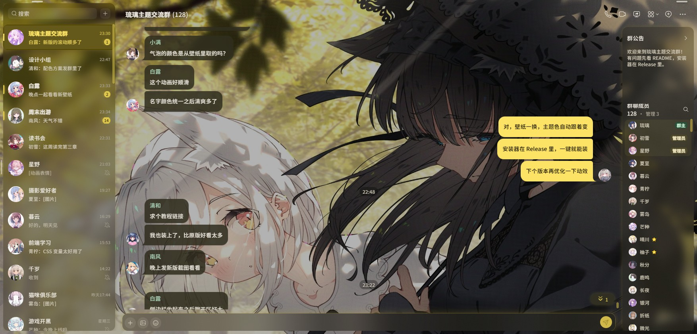
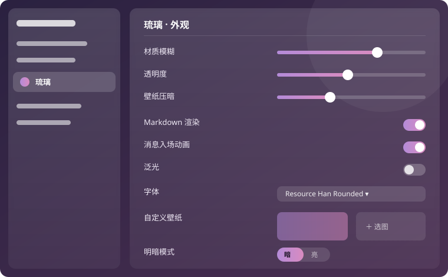

<div align="center">

# 🌊 琉璃 Liuli

**把 DSH 客户端的「琉璃」视觉语言搬到 QQNT 上的主题插件**

[](https://github.com/LiteLoaderQQNT/LiteLoaderQQNT)
[](https://im.qq.com/)
[](#)
[](#)


</div>

---

> 从壁纸取色，用 Material Color Utilities 派生整套 M3 配色，给 QQNT 换上一层会跟着壁纸呼吸的磨砂玻璃外观。**不依赖 BetterQQNT。**

## 📸 预览

<div align="center">

<!-- SCREENSHOTS -->

<br/>
<sub>实机截图（名字、消息、头像为演示内容）</sub>

<br/><br/>



<br/>
<sub>设置页为示意图</sub>

</div>

## ✨ 功能

| | 功能 | 说明 |
|---|---|---|
| 🎨 | **动态色板** | 从壁纸取色，用 Material Color Utilities 派生整套 M3 配色，亮/暗跟随 QQ |
| 🧊 | **磨砂玻璃** | 会话列表、详情栏、弹层、右键菜单都是壁纸上的半透明材质 |
| 💬 | **TG 式布局** | 连续消息合并、名字进气泡、单行输入栏、指向唤出的顶部胶囊 |
| 📝 | **Markdown 行内渲染** | `` `代码` ``、`**粗体**`、`*斜体*`、`~~删除线~~`、`\|\|剧透\|\|`（移植自 BetterQQNT） |
| 🔔 | **@ 高亮** | @我 / @全体成员 暖色淡底，@别人 品牌色 |
| 🖌️ | **名字颜色** | 统一用 MCU 派生的第三色（tertiary），和主题同源又一眼可分 |
| 🌀 | **消息入场** | 打开会话时级联浮入，新消息单条浮入（遵守系统「减少动画」） |
| 🔤 | **自定义字体** | 设置页里选本机已安装的字体 |
| 🧩 | **布局自定义** | 右键菜单可切「只显示图标」并自定义顺序；输入框里放几个按钮、放哪些、顺序，「更多」宫格里的顺序都能调；左侧边栏可隐藏空间、更多等按钮 |
| ⚙️ | **设置页** | 材质模糊/透明度/泛光/阴影/壁纸压暗、自定义壁纸、明暗模式、Markdown 开关、字体 |

## 📦 安装

### 方式一：一键安装器（推荐）

到 **[Releases](https://github.com/LilycleHeart/qqnt-liuli-theme/releases/latest)** 下载 `QQNT-LiteLoader-Installer.exe`，双击点「一键安装」，它会自动装好 LiteLoaderQQNT + 本主题并重开 QQ。「还原」按钮可一键回退。

> 安装器只装 **LiteLoader + 琉璃主题**。

### 方式二：手动安装

**第一步：装好 LiteLoaderQQNT**

本插件是标准 [**LiteLoaderQQNT**](https://github.com/LiteLoaderQQNT/LiteLoaderQQNT) 插件，先按官方方式让 QQ 加载 LiteLoader。

QQ 9.9.x 会校验自身文件，直接改会被拦。用**文件校验补丁**绕过（向作者索取，或从上面的安装器里解出）：

| 文件 | 放到哪里 | 作用 |
|---|---|---|
| `dbghelp_x64.dll` → 改名 `dbghelp.dll` | QQ 安装目录（和 `QQ.exe` 同级，如 `C:\Program Files\Tencent\QQNT\`） | 跳过文件校验，加载 LiteLoader |
| `QQ.exe`（补丁版） | QQ 安装目录，覆盖原来的 | 配套补丁，缺它启动会报「文件损坏」 |

> **先备份**原来的 `dbghelp.dll` 和 `QQ.exe` 再覆盖。完整步骤见 [LiteLoaderQQNT 官方文档](https://liteloaderqqnt.github.io/guide/install.html)。

**第二步：装插件**

1. 把本仓库放到 `LiteLoaderQQNT\plugins\liuli-dsh-theme\`
2. 重启 QQ
3. QQ 设置左栏找到「**琉璃**」，选一张壁纸，主题色就从它取

### 兼容性提示

在 QQ 9.9.36（Windows，Electron 40）上测试。LiteLoaderQQNT 1.4.1 在这个版本上需要把 `src/main/store.js` 里的 `dirent.path` 改成 `LiteLoader.path.plugins`（Electron 40 去掉了 `fs.Dirent.path`）。

## 🗂️ 结构

```
manifest.json
main/index.js        主进程：日志、自己的 uid（给 @ 高亮用）
preload/index.js     暴露 selfUid 给界面
renderer/index.js    注入 CSS、路由作用域、动态色板、布局修补、Markdown、@ 高亮、入场动画、设置页
assets/              各层 CSS、MCU（mcu.js）、图标
```

## 🕳️ 踩过的坑（改之前必看）

1. **`data-hash` / `data-liuli-scope` 必须自己同步**。主题规则挂在 `body[data-hash^="#/main"]` 和 `body[data-liuli-scope="main"]` 下。QQ 9.9.36 的 vue-router 不派发 hashchange，要用定时器轮询兜底（400ms）。
2. **`--ll-*` 令牌必须齐**。缺一个可能让整条声明作废：`--ll-scrim` 缺失时 `rgba(var(--ll-scrim), …)` 解析失败，壁纸静默消失。
3. **CSS 里不能用 `url("local://…")`**，`background-image` 会被 CSP 挡掉。壁纸必须 base64 内联。
4. **`#app::before` 承载壁纸**，不能放 body：`#app` 有 `overflow:hidden`，`.global-container` 是 `position:fixed; z-index:1`。
5. **右键菜单不能挂 backdrop-filter / transform**：「输入」/「时唤起」的子菜单是嵌在父菜单里的 `position:fixed`，父级一旦成为定位参照，子菜单就错位。模糊放在 `::before` 上。
6. **不要盖全屏噪点层、不要给气泡文字加阴影**：两者都会让字发虚。半透明层上的字只能用灰度抗锯齿，本来就比 ClearType 软。
7. **滚动时不要读 `innerText`**：会强制排版。DOM 观察回调要合并（150ms），只读 `textContent`。
8. **消息数据**：`.message` 元素上的 `__VUE__[0].props.msgRecord`。

## 🖼️ 壁纸

插件不带默认壁纸。装好后在设置页「琉璃」里选一张图，主题色会从这张图取。

也可以放一张本地默认壁纸（不会被提交）：
- `assets/wallpaper.jpg`：取色用
- `assets/wallpaper.css`：内联成 base64 的 `#app::before` 背景（CSS 里不能用 `local://`，见坑 3）

没有壁纸时取色回退到 `#1d9bf0`。

## 📋 待办

- 亮色模式尚未完整实测
- BetterQQNT 里「单条消息右键禁用 Markdown」未移植

---

<div align="center">
<sub>移植自 <a href="https://github.com/LilycleHeart/dsh-liuli-ui-enhance">dsh-liuli-ui-enhance</a> · 基于 <a href="https://github.com/LiteLoaderQQNT/LiteLoaderQQNT">LiteLoaderQQNT</a></sub>
</div>
