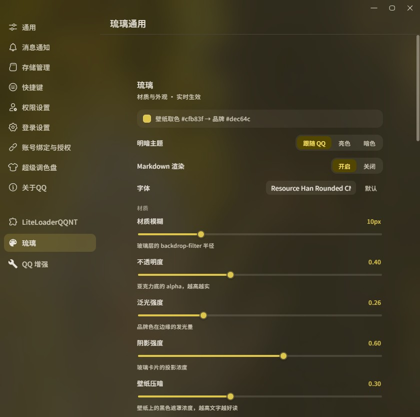

<div align="center">

# 🌊 琉璃 Liuli

**把 DSH 客户端的「琉璃」视觉语言搬到 QQNT 上的主题插件**

[](https://github.com/LiteLoaderQQNT/LiteLoaderQQNT)
[](https://im.qq.com/)
[](#)
[](#)


</div>

---

> 从壁纸取色，用 Material Color Utilities 派生整套 M3 配色，给 QQNT 换上一层会跟着壁纸呼吸的磨砂玻璃外观。**不依赖 BetterQQNT。**

> [!IMPORTANT]
> **只支持 Windows 版 QQ 9.9.36**（LiteLoaderQQNT 1.4.1）。我们只在这个版本上开发和测试，其它版本（更旧的 9.9.21、9.9.28，或以后的新版）不保证兼容，可能出现输入框点不动、界面错位、启动报「文件已损坏」等问题。遇到问题请先把 QQ 更新 / 安装到 9.9.36 再试，详见 [支持的版本](#支持的版本)。

## 📸 预览

<div align="center">

<!-- SCREENSHOTS -->

<br/>
<sub>实机截图（名字、消息、头像为演示内容）</sub>

<br/><br/>



<br/>
<sub>设置页实机截图</sub>

</div>

## ✨ 功能

| | 功能 | 说明 |
|---|---|---|
| 🎨 | **动态色板** | 从壁纸取色，用 Material Color Utilities 派生整套 M3 配色，亮/暗跟随 QQ；「配色」里可以指定强调色、选中项、自己和对方的气泡各用哪种颜色 |
| 🧊 | **磨砂玻璃** | 会话列表、详情栏、弹层、右键菜单都是壁纸上的半透明材质 |
| 💬 | **TG 式布局** | 连续消息合并、名字进气泡、单行输入栏、指向唤出的顶部胶囊 |
| 📝 | **Markdown 行内渲染** | `` `代码` ``、`**粗体**`、`*斜体*`、`~~删除线~~`、`\|\|剧透\|\|`（移植自 BetterQQNT） |
| 🔔 | **@ 高亮** | @我 / @全体成员 暖色淡底，@别人 品牌色 |
| 🌐 | **卡片用浏览器打开** | 装了 LiteLoader 后点 B 站、腾讯文档等「QQ小程序」卡片会弹「文件已损坏」，琉璃改成取卡片里的网页链接用默认浏览器打开。同时装了 QQ 增强时交给 QQ 增强处理，不会打开两次 |
| 🖌️ | **名字颜色** | 统一用 MCU 派生的第三色（tertiary），和主题同源又一眼可分 |
| 🌀 | **消息入场** | 打开会话时级联浮入，新消息单条浮入（遵守系统「减少动画」） |
| 🔤 | **自定义字体** | 设置页里选本机已安装的字体 |
| 🧩 | **布局自定义** | 右键菜单可切「只显示图标」并自定义顺序；输入框里放几个按钮、放哪些、顺序，「更多」宫格里的顺序都能调；左侧边栏可隐藏空间、更多等按钮；窗口按钮可选「悬浮」或「常驻（原版标题栏）」 |
| ⚙️ | **设置页** | 材质模糊/透明度/泛光/阴影、壁纸遮罩（亮色、暗色主题分开设置，颜色可选亮或暗；滑条提示里有推荐区间）、自定义壁纸（壁纸太亮或太暗、和明暗模式不搭时会提示切换）、明暗模式、配色、Markdown 开关、字体 |
| 🩺 | **导出诊断包** | 设置页「诊断」小节把环境、插件状态、日志、壁纸状态打成 zip，排查「启动报错」「壁纸不显示」 |

## 📦 安装

### 方式一：一键安装器（推荐）

到 **[Releases](https://github.com/LilycleHeart/qqnt-liuli-theme/releases/latest)** 下载 `QQNT-LiteLoader-Installer.exe`，双击点「一键安装」，它会自动装好 LiteLoaderQQNT + 本主题并重开 QQ。「还原」按钮可一键回退。

> 安装器只装 **LiteLoader + 琉璃主题**。

### 方式二：手动安装

**第一步：装好 LiteLoaderQQNT**

本插件是标准 [**LiteLoaderQQNT**](https://github.com/LiteLoaderQQNT/LiteLoaderQQNT) 插件，先按官方方式让 QQ 加载 LiteLoader。

QQ 9.9.x 会校验自身文件，直接改会被拦。用**文件校验补丁**绕过（向作者索取，或从上面的安装器里解出）：

| 文件 | 放到哪里 | 作用 |
|---|---|---|
| `dbghelp_x64.dll` → 改名 `dbghelp.dll` | QQ 安装目录（和 `QQ.exe` 同级，如 `C:\Program Files\Tencent\QQNT\`） | 跳过文件校验，加载 LiteLoader |
| `QQ.exe`（补丁版） | QQ 安装目录，覆盖原来的 | 配套补丁，缺它启动会报「文件损坏」 |

> **先备份**原来的 `dbghelp.dll` 和 `QQ.exe` 再覆盖。完整步骤见 [LiteLoaderQQNT 官方文档](https://liteloaderqqnt.github.io/guide/install.html)。

**第二步：装插件**

1. 把本仓库放到 `LiteLoaderQQNT\plugins\liuli-dsh-theme\`
2. 重启 QQ
3. QQ 设置左栏找到「**琉璃**」，选一张壁纸，主题色就从它取

### 支持的版本

| 项目 | 版本 |
|---|---|
| QQ | **Windows 9.9.36**（Electron 40），唯一支持的版本 |
| LiteLoaderQQNT | 1.4.1（安装器内置） |

我们只在 QQ 9.9.36 上开发和测试，**不保证其它版本的兼容性**，也不针对其它版本修问题。已知旧版问题：9.9.28 上输入框只有最左边一条能点（同一台机器换 9.9.36 正常）。提 issue 前请先确认 QQ 是 9.9.36（QQ 设置 → 关于）。

手动安装时注意：LiteLoaderQQNT 1.4.1 在这个版本上需要把 `src/main/store.js` 里的 `dirent.path` 改成 `LiteLoader.path.plugins`（Electron 40 去掉了 `fs.Dirent.path`）。

## 🗂️ 结构

```
manifest.json
main/index.js        主进程：日志、自己的 uid（给 @ 高亮用）、诊断包导出（main/diag.js）
preload/index.js     暴露 selfUid / openExternal / diagExport / diagLog / diagOpenPath
renderer/index.js    注入 CSS、路由作用域、动态色板、布局修补、Markdown、@ 高亮、入场动画、设置页
renderer/diag.js     渲染进程诊断：启动标记、错误环形缓冲、本地存储/壁纸快照、壁纸操作审计
assets/              各层 CSS、MCU（mcu.js）、图标
```

## 🕳️ 踩过的坑（改之前必看）

1. **`data-hash` / `data-liuli-scope` 必须自己同步**。主题规则挂在 `body[data-hash^="#/main"]` 和 `body[data-liuli-scope="main"]` 下。QQ 9.9.36 的 vue-router 不派发 hashchange，要用定时器轮询兜底（400ms）。
2. **`--ll-*` 令牌必须齐**。缺一个可能让整条声明作废：`--ll-scrim` 缺失时 `rgba(var(--ll-scrim), …)` 解析失败，壁纸静默消失。
3. **CSS 里不能用 `url("local://…")`**，`background-image` 会被 CSP 挡掉。壁纸必须 base64 内联。
4. **`#app::before` 承载壁纸**，不能放 body：`#app` 有 `overflow:hidden`，`.global-container` 是 `position:fixed; z-index:1`。
5. **右键菜单不能挂 backdrop-filter / transform**：「输入」/「时唤起」的子菜单是嵌在父菜单里的 `position:fixed`，父级一旦成为定位参照，子菜单就错位。模糊放在 `::before` 上。
6. **不要盖全屏噪点层、不要给气泡文字加阴影**：两者都会让字发虚。半透明层上的字只能用灰度抗锯齿，本来就比 ClearType 软。
7. **滚动时不要读 `innerText`**：会强制排版。DOM 观察回调要合并（150ms），只读 `textContent`。
8. **消息数据**：`.message` 元素上的 `__VUE__[0].props.msgRecord`。

## 🖼️ 壁纸

插件不带默认壁纸。装好后在设置页「琉璃」里选一张图，主题色会从这张图取。

也可以放一张本地默认壁纸（不会被提交）：
- `assets/wallpaper.jpg`：取色用
- `assets/wallpaper.css`：内联成 base64 的 `#app::before` 背景（CSS 里不能用 `local://`，见坑 3）

没有壁纸时取色回退到 `#1d9bf0`。

### 壁纸不显示怎么排查

1. **先重选一次图**：保存失败不再被静默吞掉，会直接弹 toast（含异常名与消息），例如 `QuotaExceededError: …`。
2. **选图会自动压缩**：原图（≤2560 宽）优先保留，超预算再按 2560 → 1920 → 1440 → 1080 宽、质量 0.86 → 0.8 逐档压，目标 dataURL ≤3.5MB；仍超限会在 toast 里说明（仍允许保存，localStorage 写失败再提示）。
3. **跨窗口同步兜底**：每次保存会写 `liuli-dsh-wallpaper-rev`（毫秒字符串），主窗口每 1.5 秒只读这个小键，变了才重新读壁纸并渲染；`storage` 事件路径保留，两条路都能到。主窗口启动时若本地有壁纸但 `#app::before` 没有背景图，会自动重渲染一次。
4. **还不行就导出诊断包**（见下）：`snapshots/*.json` 里看 `wallpaper.applied.pseudoBgContainsUrl`、`wallpaper.decodeOk`、`checks` 里的 `[X]` 项，`logs/session.log` 里看 `wallpaper:persist` / `wallpaper:encode` / `wallpaper:poll` 审计。

## 🩺 导出诊断包（排障）

QQ 设置 → 左栏「**琉璃**」→ 拉到面板底部「**诊断**」小节：

- `[ ] 包含聊天窗口截图（可能包含当前聊天画面）` —— 默认**不勾**，也决定是否附带壁纸缩略图；**设置页截图默认包含**（不含聊天内容）
- 点「**导出诊断包**」，状态行显示「已导出到 …」，旁边「**打开文件夹**」直接定位到 zip
- 导出期间按钮禁用并显示「正在收集…」；失败会把异常名与消息显示在状态行、弹 toast，并写入 `session.log`（不会静默）
- 「最近错误：N 条」可展开，看本次启动捕获的错误/警告（与诊断包里的环形缓冲同一份数据）

**包里有什么**（zip 内路径只用 ASCII）：`report.txt`（人读总报告 + 结论清单）、`meta.json`、`environment.json`、`snapshots/window-<id>.json`（每个窗口的主题注入状态、`#liuli-dsh-theme` 长度/规则数、关键 CSS 变量、`#liuli-embedded` 面板控件计算样式、壁纸状态、`#app::before`、localStorage 键与配额、storage 事件、壁纸操作审计、错误环形缓冲、中文检查结论；**同步快照不含逐文件 `inStyle`**，逐文件的 CSS 加载/注入判定在 `report.txt` 第 8 节的 payload 快照与 `checks` 里）、`logs/session.log`、QQ 日志与其它插件日志尾部、设置页截图（默认）与聊天截图（勾选）。

**隐私边界**：不采集 **聊天记录库（`nt_msg.db`）**、表情/图片缓存、聊天内容；设置页截图默认包含、聊天窗口截图默认关闭；文本统一脱敏（`uin=` / `uid=` / 邮箱 / 长 base64 / `sk-` / `Bearer`）；壁纸只留长度与 MIME，**不留完整 dataURL**；localStorage 里只有琉璃自己的 `liuli-*` 键保留值预览，QQ 内核与其它插件的键只留「键名 + 长度 + 是否合法 JSON」，疑似敏感键（含 `token` / `pass` / `cookie` / `session` / `uid` / `device`）只留键名与长度。

**导出位置**：桌面 `琉璃诊断包-<yyyyMMdd-HHmmss>.zip`；桌面不可写时依次回退「文档 → 临时目录 → 插件 `data/liuli-dsh-theme/diag/`」，并额外复制一份到 `diag/`（安装器诊断包会自动带上最新一份）。`diag/` 里最多保留 3 个 zip（文件名同桌面格式），旧的自动清理。

> 安装器（`QQNT-LiteLoader-Installer.exe`）自己也能导出 `QQ诊断包-<时间戳>.zip`，那里偏系统/补丁层；插件这个包偏渲染进程与壁纸细节，两者互补。

## 📋 待办

- 亮色、暗色的颜色角色按 Material 3（Material Color Utilities）的标准配对，以「没有壁纸」为基准（亮色底纯白、暗色底纯黑）实测；壁纸太暗或太亮时请按滑条提示调高不透明度或遮罩
- BetterQQNT 里「单条消息右键禁用 Markdown」未移植

---

<div align="center">
<sub>移植自 <a href="https://github.com/LilycleHeart/dsh-liuli-ui-enhance">dsh-liuli-ui-enhance</a> · 基于 <a href="https://github.com/LiteLoaderQQNT/LiteLoaderQQNT">LiteLoaderQQNT</a></sub>
</div>
